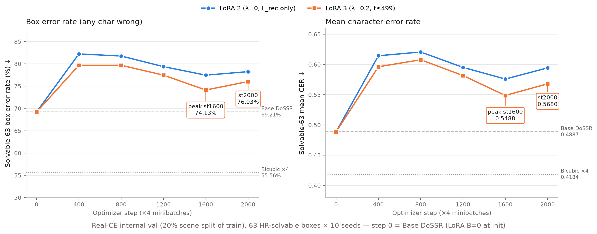
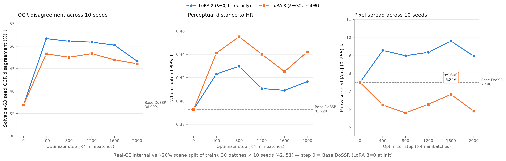

# Phase 2: Loss Audit, Timestep Gating, and Training Curves

Hồ Quang Minh (M3), Team LEMMEPASS. Source data: `results_phase2/` on the team Drive (run manifests, `phase2_timestep_gating_comparison.json`, `phase2_2000step_curves_s231.json`). Code references give full paths from the repository root.

## 1. Loss formulation and the role of $1-\eta_t$

**Forward model.** Let $x_0$ be the HR latent, $\hat x_{\text{LR}}$ the latent of the Real-ESRNet-preprocessed LR image, $t\sim\mathcal U\{0,\dots,999\}$ and $\epsilon\sim\mathcal N(0,I)$. DoSSR's `predict_x0_out_mix` (`external/DOSSR/ldm/models/diffusion/ddpm.py:909-916`) computes

$$x_t = \sqrt{\bar\alpha_t}\,\big(\eta_t\hat x_{\text{LR}} + (1-\eta_t)x_0\big) + \sqrt{1-\bar\alpha_t}\,\epsilon, \qquad \hat x_0 = \frac{x_t}{\sqrt{\bar\alpha_t}} - \sqrt{\frac{1}{\bar\alpha_t}-1}\;\hat\epsilon_\theta(x_t,t,c).$$

Our fine-tuning minimises a text-weighted L1 between $\hat x_0$ and $x_0$, with weight $w = 1+4m$ inside text boxes ($\alpha_{\text{text}}=5$; `src/lora_text_loss.py:290-293`).

**Training never divides by $1-\eta_t$.** The only divisor is $\sqrt{\bar\alpha_t}$, which stays at or above 0.0683 for all $t$ (Table 1). The shift schedule `trunc_12` (`external/DOSSR/ldm/modules/diffusionmodules/util.py:32-36`) sets $\eta_t=\tfrac12(1-\cos\pi s_t)$ for $t<500$ and $\eta_t=1$ for $t\ge500$. On half of the training timesteps, therefore, the network input contains no HR information.

**Inference does divide by $1-\eta_t$** (`external/DOSSR/model/shift_sampler.py:157, 236`), so the sampler is restricted to $t<500$. With 5 steps, `space_timesteps(500, "6")` produces knots $\{0,100,200,299,399,499\}$, and the UNet is evaluated at $t\in\{499,399,299,200,100\}$ (`external/DOSSR/model/shift_sampler.py:122, 211-232`). Gating the consistency loss to $t\le499$ thus covers every timestep used at inference.

*Table 1. DoSSR schedules at selected timesteps (float64, recomputed from source).*

| $t$ | 0 | 100 | 200 | 299 | 399 | 499 | 500 | 999 |
|---|---|---|---|---|---|---|---|---|
| $1-\eta_t$ | 1.0000 | 0.9036 | 0.6530 | 0.3470 | 0.0964 | $2.47\times10^{-6}$ | 0 | 0 |
| $\sqrt{\bar\alpha_t}$ | 0.9996 | 0.9456 | 0.8682 | 0.7695 | 0.6528 | 0.5269 | 0.5257 | 0.0683 |

**Two-pass gradient.** With two noise draws $p_a,p_b$ at the same $t$, the objective is $\mathcal L=\tfrac12\mathcal L_{\text{rec}}(p_a)+\tfrac12\mathcal L_{\text{rec}}(p_b)+\lambda\,\mathrm{mean}(w_c|p_a-p_b|)$. To keep only one activation graph in memory, `run_two_noise_step` (`src/lora_text_loss.py:319-401`) back-propagates $\tfrac12\mathcal L_{\text{rec}}(p_a)+\lambda\,\mathrm{mean}(w_c|p_a-\mathrm{sg}(p_b)|)$ and then the symmetric term for $p_b$. Each pass contributes one of the two chain-rule terms of $\nabla_\theta\mathcal L_{\text{cons}}$, so the summed gradient equals $\nabla_\theta\mathcal L$, provided the forward pass is deterministic. Here the model is in eval mode, LoRA dropout is 0, and $t$ and the noise are shared between passes. Table 2 confirms the equivalence numerically. This check was run in FP32; the training runs behind Tables 3–4 use FP16 autocast (`configs/lora*_full2000_s231.yaml:27`), for which the equivalence holds only up to FP16 rounding and was not measured separately. Peak memory is the same for LoRA 2 and LoRA 3 (8.04 GiB allocated) because in both cases each pass is back-propagated and its graph freed before the next pass starts, and the extra peer pass in LoRA 3 runs without gradient tracking.

*Table 2. FP32 gradient check, joint backward vs. two-pass backward ($\alpha_{\text{text}}=5$). Rows 1–2 use $\lambda=0.2$ and are reported in plan 08. Row 3 is the live `--verify-fp32-grad` check, run before step 1 of the `lora3-lambda01-pilot` training run with that run's $\lambda=0.1$ (`scripts/run_lora_trial.py:1074-1081`), and recorded in its run manifest.*

| Setting | Params | Loss abs. diff | Max abs. grad diff | Rel. $L_2$ grad diff |
|---|---|---|---|---|
| CPU toy, grad_accum = 1 | toy | 1.79e-07 | 0 | 0 |
| CPU toy, grad_accum = 4 | toy | 5.66e-08 | 1.49e-08 | 4.11e-08 |
| ControlLDM, 32×32 latent | 1,659,904 | 9.54e-08 | 1.93e-07 | 2.08e-05 |

## 2. Timestep gating of the consistency loss

All runs use training seed 231 and hence the same timestep sequence. Over 1,600 minibatches, 814 (50.88%) fall in $t<500$; over 8,000 minibatches, 3,948 (49.35%) do. Gating therefore activates $\mathcal L_{\text{cons}}$ on about half of the minibatches. On the other half, both reconstruction forward passes still run; only the additional no-gradient peer forward pass used by $\mathcal L_{\text{cons}}$ is skipped.

*Table 3. Effect of gating at $\lambda=0.2$, 400 steps. Internal validation split (30 patches from the 20% scene split of the official Real-CE training pairs), 63 HR-solvable boxes, seeds 42–51. Source: `results_phase2/phase2_timestep_gating_comparison.json` (Drive), `category_breakdown.solvable_63`; s/step from the run manifests.*

| | BoxErr | CER | Seed disag. | numeric CER | latin CER | border CER | CJK CER | s/step |
|---|---|---|---|---|---|---|---|---|
| all $t$ | 79.37% | 0.5918 | 48.29% | 0.5754 | 0.4365 | 0.6886 | 0.7009 | 5.436 |
| $t\le499$ | 79.68% | 0.5962 | 48.32% | 0.5732 | 0.4480 | 0.6955 | 0.7050 | 5.105 |

Gating does not change OCR quality measurably: all differences are at most 0.012 CER, with small changes in both directions across categories. It reduces training time per step by 6.1%. We keep $t\le499$ because the analysis in Section 1 supports it and it is cheaper, not because it improved accuracy.

## 3. Training curves over 2,000 steps

We trained LoRA 2 ($\lambda=0$) and LoRA 3 ($\lambda=0.2$, $t\le499$) for 2,000 steps (8,000 minibatches) and evaluated a checkpoint every 400 steps. LoRA B is zero-initialised, so step 0 is identical to Base DoSSR.

*Figure 1. Box error rate and mean CER on the 63 HR-solvable boxes (10 seeds). Dashed: Base DoSSR. Dotted: bicubic ×4.*

*Figure 2. Seed OCR disagreement (63 boxes), whole-patch LPIPS, and mean pairwise pixel difference between seeds (30 patches).*

*Table 4. Values plotted in Figures 1–2 (L2 = LoRA 2, L3 = LoRA 3).*

| Step | BoxErr L2 | BoxErr L3 | CER L2 | CER L3 | LPIPS L2 | LPIPS L3 | px L2 | px L3 |
|---|---|---|---|---|---|---|---|---|
| 0 | 69.21% | 69.21% | 0.4887 | 0.4887 | 0.3928 | 0.3928 | 7.486 | 7.486 |
| 400 | 82.22% | 79.68% | 0.6144 | 0.5962 | 0.4231 | 0.4411 | 9.271 | 6.226 |
| 800 | 81.75% | 79.68% | 0.6206 | 0.6078 | 0.4298 | 0.4551 | 8.973 | 5.786 |
| 1200 | 79.37% | 77.46% | 0.5952 | 0.5817 | 0.4107 | 0.4401 | 9.164 | 6.267 |
| 1600 | 77.46% | 74.13% | 0.5759 | 0.5488 | 0.4091 | 0.4252 | 9.790 | 6.816 |
| 2000 | 78.25% | 76.03% | 0.5944 | 0.5680 | 0.4167 | 0.4422 | 8.951 | 5.888 |

LoRA 3 has lower box error and CER than LoRA 2 at every checkpoint. Both runs are best at step 1,600 and degrade slightly at step 2,000. Because step 1,600 was selected on the same internal validation patches it is reported on, its scores are optimistic; an unbiased estimate requires evaluating the selected checkpoint once on the held-out official RealCE/val split (300 pairs), which has not been used so far. LoRA 3 also has lower pixel-level seed spread than Base DoSSR at every checkpoint (5.79–6.82 vs. 7.49), although its seed OCR disagreement stays higher (46.98% vs. 36.90% at step 1,600). On the other hand, LoRA 3 has higher LPIPS than LoRA 2 throughout, which is consistent with the smoothing effect of the consistency loss.

## 4. Discussion: why Base DoSSR still leads on OCR

No checkpoint reaches Base DoSSR on OCR (74.13% vs. 69.21% box error), and none reaches bicubic upsampling (55.56%). Fine-tuning first degrades OCR: after 400 steps, LoRA 2 is 13.01 pp worse than step 0. Of the subsequent 8.09 pp recovery up to LoRA 3 at step 1,600, 4.76 pp also occurs in LoRA 2 and so comes from longer training. The remaining 3.33 pp gap between LoRA 3 and LoRA 2 is consistent with a benefit from the consistency loss, and LoRA 3 leads at all five checkpoints, but with one training seed we cannot separate this gap from run-to-run variance.

One possible cause is the timestep distribution of $\mathcal L_{\text{rec}}$: 50.65% of minibatches have $t\ge500$, where the input carries no HR information and which inference never visits. This spends a small LoRA budget on a regime that does not affect outputs. However, DoSSR pre-training samples the same range with the same loss (`external/DOSSR/model/cldm.py:346-353`), so this is a hypothesis rather than an established cause. A direct test is a 400-step run with $\mathcal L_{\text{rec}}$ also restricted to $t\le499$. Alternative explanations we have not excluded are the text-weighted loss ($\alpha_{\text{text}}=5$), FP16 training, and overfitting to the small training split.

## 5. Limitations

All results come from a single training seed (231) and 63 HR-solvable boxes, so differences of a few percentage points between LoRA variants, including the 3.33 pp gap in Section 4, may be within run-to-run variance. The 30 evaluation patches come from the internal 20% scene split of the official training pairs, and the reported checkpoint was chosen on them; the official RealCE/val split remains untouched for final testing. The two CPU rows in Table 2 were not re-run for this report. The figures can be regenerated with `python scripts/plot_phase2_curves.py`.
