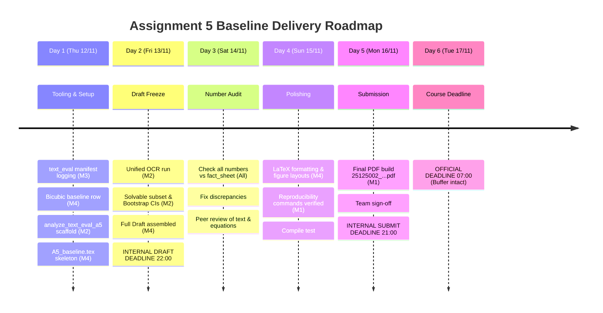

# Plan 06c — Group Assignment 5 (`Baseline` Report) Master Implementation Plan

**Course:** SC203 Scientific Methods (Class 25A02) — Team 1 (`LEMMEPASS`)  
**Official Assignment Brief:**  
> *"Every team is required to submit a report about your baseline (e.g., approach, experimental results, etc.). Each team must submit one PDF report using the following filename format: `<StudentID1>_<StudentID2>_....pdf`"*

**Output Artifact Filename:** `25125002_25125042_25125060_25125033.pdf`  
(Students: Nguyễn Anh `25125002`, Gia Hân `25125042`, Quang Minh `25125060`, Minh Nhật `25125033`)  
**Official Deadline:** **Tuesday 17/11/2026 07:00**  
**Internal Full Draft Deadline:** **Friday 13/11/2026 22:00**  
**Internal Submit Deadline:** **Monday 16/11/2026 21:00** (10-hour safety buffer)  
**Plan Revision Date:** Wednesday night, `11/11/2026`  

---

## 1. Core Principles & Decoupling Rule

1. **Strict Decoupling:**
   - **Assignment 5 is 100% a Baseline Report.** It documents our DoSSR baseline implementation, runtime compatibility adaptations (SDPA, FP16, prompt wrapper), equivalence verifications, 10-seed whole-image evaluations, and in-depth text-region evaluation (including A4-review statistical improvements).
   - **A5 does NOT depend on LoRA.** LoRA training is an independent research exploration track for the mentor's next progress update. A5 will mention LoRA in at most one short paragraph in the Future Work / Discussion section if preliminary trials complete before the freeze.
2. **Fact-Checked & Audited Numbers Only:**
   - Every metric reported in `docs/A5_baseline.tex` must trace to an exact CSV or logged manifest in `results/` and be audited against `docs/fact_sheet_for_report.md`.
   - Any pending metric is explicitly tagged `PENDING` until calculated and verified. No approximate or hand-waved numbers are allowed.
3. **Single Filename Standard:**
   - The compiled PDF must be strictly named `25125002_25125042_25125060_25125033.pdf`.

---

## 2. A5 Baseline Report Architecture (`docs/A5_baseline.tex`)

The baseline report is structured into 6 core sections:

```
docs/A5_baseline.tex
├── Section 1: Introduction & Baseline Problem Formulation
│   ├── Real-world 4x Super-Resolution challenge on RealSR (Canon 5D3 & Nikon D810).
│   └── The specific vulnerability of generative diffusion SR models on fine text structures.
├── Section 2: Baseline Approach & Technical Implementation
│   ├── Baseline Model: DoSSR (Diffusion-based RealSR, Stable Diffusion 2.1 base, 5 inference steps via 3rd-order solver with trunc_12 schedule).
│   ├── Runtime compatibility adaptations: PyTorch SDPA integration, empty prompt wrapper, FP16 precision.
│   └── Equivalence verification: SDPA ON vs OFF, prompt wrapper equivalence, seed determinism test.
├── Section 3: Experimental Setup & Metric Definitions
│   ├── Evaluation dataset: RealSR test set (100 images: 50 Canon, 50 Nikon; 25 text images, 193 GT boxes).
│   ├── Whole-image metric protocol: BT.601 Y-channel PSNR, SSIM (11x11, sigma=1.5), LPIPS (AlexNet).
│   └── Text-specific metric protocol: Word Correct Rate (WCR), Character Error Rate (CER), OCR manifest.
├── Section 4: Quantitative & Qualitative Baseline Results
│   ├── Whole-image benchmark table: Bicubic 4x vs DoSSR (Default) vs DoSSR (Empty Prompt) across 10 seeds.
│   ├── Text-region evaluation table: HR Ceiling, Bicubic floor, DoSSR default, DoSSR empty across 193 boxes.
│   └── Methodological upgrades (A4 review):
│       ├── OCR-solvable subset (136 boxes recognizable on HR ceiling).
│       ├── Image-level bootstrap 95% confidence intervals (resampling over 25 images).
│       ├── Capped CER min(CER, 1.0) and median CER (mitigating extreme insertion penalties).
│       └── Non-text control boxes: matched-size crops measuring baseline pixel seed variance vs text hallucination.
├── Section 5: Baseline Findings, Error Modes & Limitations
│   ├── Distortion-perception trade-off (high LPIPS/visual sharpness vs low PSNR/pixel fidelity).
│   ├── Stochastic text hallucination: high seed disagreement (32.83%) and character morphing.
│   └── Text-box seed variance significantly exceeding non-text control box variance.
└── Section 6: Reproducibility & Open Source Artifacts
    ├── Exact repository layout, checkpoints, and environment requirements.
    └── One-line CLI commands to reproduce inference, metric evaluation, and OCR analysis.
```

---

## 3. Work Division & Responsibilities (4 Members)

| Member | Role | Primary Assignment for A5 | Dependencies / Hand-offs |
| :--- | :--- | :--- | :--- |
| **Member 1** (`Nguyên Anh`) | **Team Lead & Quality Gate** | • Project coordination and schedule enforcement.<br>• Run/verify Colab jobs or missing compute if needed.<br>• Lead Number-Audit Checklist verification against `docs/fact_sheet_for_report.md`.<br>• Compile and submit `25125002_25125042_25125060_25125033.pdf` by Mon 16/11 21:00. | Final gatekeeper for all member contributions. |
| **Member 4** (`Minh Nhật`) | **Lead Report Author** | • Lead author for `docs/A5_baseline.tex`.<br>• Write Sections 1 (Intro), 2 (Approach & Implementation), 3 (Setup & Metric Math), 5 (Limitations), and 6 (Reproducibility).<br>• Generate `Bicubic x4` whole-image baseline metrics using `scripts/compute_metrics.py`. | Receives statistical tables from M2; works closely with M1 on audit. |
| **Member 2** (`Gia Hân`) | **Evaluation & Statistics Specialist** | • Run unified single-OCR evaluation across all 193 boxes (`default` & `empty` prompt) with manifest logging.<br>• Implement and execute `scripts/analyze_text_eval_a5.py` to produce:<br>&nbsp;&nbsp;1. OCR-solvable subset (`136` boxes).<br>&nbsp;&nbsp;2. Image-level bootstrap 95% CIs.<br>&nbsp;&nbsp;3. Capped CER and median CER.<br>&nbsp;&nbsp;4. Non-text control boxes pixel seed spread.<br>• Provide finalized LaTeX tables and figures for Section 4. | Delivers tables to M4 by Fri 13/11 12:00. |
| **Member 3** (`Quang Minh`) | **Tooling & Parallel Track Support** | • Verify implementation equivalence logs (SDPA ON/OFF, seed repeatability).<br>• Add manifest logging to `scripts/text_eval.py` (recording backend, version, upscale, flags).<br>• Support M4 on Section 2 equivalence write-up.<br>• Parallel track: CPU unit tests `(a)`–`(f)` for LoRA and inspect `Real-CE` feasibility. | Delivers equivalence table to M4 by Thu 12/11 21:00. |

---

## 4. Master Timeline & Milestones (`Thu 12/11` – `Tue 17/11/2026`)



### Detailed Schedule:

- **Thursday 12/11/2026 (Tooling & Baseline Generation):**
  - `M3`: Add OCR run manifest logger to `scripts/text_eval.py` (record RapidOCR version, ONNX provider, upscale, language).
  - `M4`: Run `scripts/compute_metrics.py` on Bicubic x4 images to produce the official reference row (`PSNR`, `SSIM`, `LPIPS`).
  - `M2`: Scaffold `scripts/analyze_text_eval_a5.py` and run unified OCR on all 193 boxes (`default` and `empty` prompt).
  - `M4`: Set up `docs/A5_baseline.tex` with initial verified numbers and draft Sections 1, 2, and 3.

- **Friday 13/11/2026 (Statistical Analyses & Full Draft Assembly):**
  - `M2` (by 18:00): Run `scripts/analyze_text_eval_a5.py` to extract:
    1. Solvable subset performance (136 boxes).
    2. Bootstrap 95% CIs across images for WCR, CER, PSNR, SSIM, LPIPS.
    3. Capped CER and median CER.
    4. Non-text control boxes seed variance vs text boxes.
  - `M4` (by 22:00): Integrate all tables and figures into `docs/A5_baseline.tex`.
  - **MILESTONE: INTERNAL FULL DRAFT DEADLINE (Friday 13/11 22:00).** All sections populated; no empty sections.

- **Saturday 14/11/2026 (Number-Audit Checklist & Verification):**
  - `All 4 Members`: Audit every single number in `docs/A5_baseline.tex` line by line against `docs/fact_sheet_for_report.md`.
  - Mark each cell as `VERIFIED` with its backing CSV / log file, or fix any discrepancy immediately.
  - Ensure metric definitions (BT.601 Y, SSIM Gaussian window, LPIPS AlexNet) are mathematically exact.

- **Sunday 15/11/2026 (Visual Polish, Layout & Reproducibility):**
  - `M4` & `M1`: Polish LaTeX layout, typography, captions, and table aesthetics.
  - `M1`: Verify reproducibility steps in Section 6 on a fresh shell/Colab instance.
  - Test compile locally and on Overleaf.

- **Monday 16/11/2026 (Final Proofread & Early Submission):**
  - `19:00`: Final team proofreading walk-through.
  - `20:00`: Export final PDF: `25125002_25125042_25125060_25125033.pdf`.
  - **MILESTONE: INTERNAL FINAL SUBMIT DEADLINE (Monday 16/11 21:00).**
  - `M1`: Submit file to course submission portal, verify upload integrity, take timestamped receipt screenshot.

- **Tuesday 17/11/2026 07:00:**
  - **OFFICIAL COURSE DEADLINE.** (Completed 10 hours in advance).

---

## 5. Statistical & Methodological Upgrades (A4 Review Responses)

To ensure scientific rigor in A5, the following four methodological upgrades are implemented and reported:

| Upgrade | Motivation / Why Needed | Implementation Method | Output in A5 Report |
| :--- | :--- | :--- | :--- |
| **1. Unified Single-OCR Run** | In A4, Canon had upscale 2 while Nikon had upscale 1, and exact RapidOCR package version was not recorded. | Run all 193 boxes in one pass with identical upscale and record package version, ONNX backend, and flags in manifest. | Explicit "OCR Configuration" paragraph in Section 3 and clean comparative table. |
| **2. OCR-Solvable Subset (`136` boxes)** | 57 boxes failed OCR on ground-truth HR images due to severe low-light, blur, or extreme angle. Assessing SR models on unreadable HR distorts CER/WCR. | Filter boxes where HR OCR correctly identified text ($WCR > 0$). Evaluate models on this 136-box subset. | Side-by-side reporting: Full set (193 boxes) vs. Solvable subset (136 boxes). |
| **3. Image-Level Bootstrap 95% CIs** | Text boxes within the same image are correlated; simple standard error over pooled boxes underestimates uncertainty. | 1,000 bootstrap resamples at the image level ($N=25$ text images). Compute empirical 2.5% and 97.5% percentiles. | Report values as $\text{Mean} \; [95\%\; \text{CI}_{\text{lower}}, \text{CI}_{\text{upper}}]$. |
| **4. Non-Text Control Boxes** | Address reviewer question: *"Is pixel variance across seeds unique to text, or does the entire image fluctuate across seeds?"* | Sample 193 matched-size non-text crops from the same images. Calculate pixel-level cross-seed std. | Table/Bar chart showing text-box variance vs non-text control variance. |

---

## 6. Actionable Implementation Steps (Ready for Immediate Execution)

1. **Step 1:** Update and commit `scripts/text_eval.py` to record run manifest metadata.
2. **Step 2:** Create `scripts/analyze_text_eval_a5.py` implementing the 4 statistical upgrades.
3. **Step 3:** Generate Bicubic x4 whole-image metrics via `scripts/compute_metrics.py`.
4. **Step 4:** Create `docs/A5_baseline.tex` master LaTeX document with audited numbers and structured sections.
5. **Step 5:** Keep `docs/fact_sheet_for_report.md` updated as the single source of truth.
