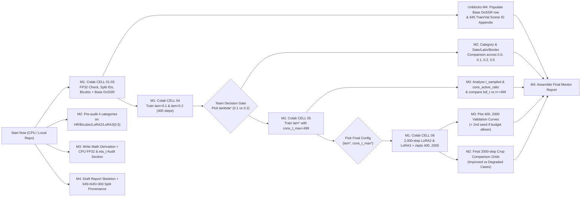

# Team Task Division, Dependencies & Execution Plan — Phase 2 LoRA Sweep & 2,000-Step Report

**Project:** SC203 Scientific Methods (Class 25A02) — Team 1 (`LEMMEPASS`)  
**Scope:** Mentor Dr. Thuận's Phase-2 Directives (Real-CE $\times 4$ $\lambda_{\text{cons}}$ Sweep, Timestep Gating $t \le 499$, Base DoSSR Validation Baseline, & 2,000-Step Checkpoint Curves)  
**Target Branch:** `feat/baseline-runner` (also synced to `main`)  
**Master Reference Notebook:** [`notebooks/04_lora_sweep_and_2000step_colab.ipynb`](../notebooks/04_lora_sweep_and_2000step_colab.ipynb)  
**Technical Architecture Plan:** [`docs/plans/08_mentor_next_lora_sweep_and_2000step_plan.md`](plans/08_mentor_next_lora_sweep_and_2000step_plan.md)

---

## 1. Design Principle: Balanced Workload & Strict Non-Overlap

In Phase 1 / A5, M1 and M3 accidentally overlapped M2's downstream evaluation before M2 started. For Phase 2, every member has **exclusive ownership** of specific deliverables, **CPU-ready pre-work starts immediately today** (before Colab finishes), and GPU runs are isolated strictly under M1 so no two people wait idly or redo each other's work:

| Member | ID | Role in Phase 2 | Immediate CPU Work (Starts Now) | Post-Colab Analysis & Report Ownership |
| :--- | :---: | :--- | :--- | :--- |
| **M1 — Hoàng Nguyên Anh** | `25125002` | **Team Lead & Colab L4 GPU Runner** | Verify repo sync, Drive storage, & run [`notebooks/04_lora_sweep_and_2000step_colab.ipynb`](../notebooks/04_lora_sweep_and_2000step_colab.ipynb) (`CELL 01–06`). | Owns GPU execution, `lora_train_log.csv`, `lora_run_manifest.json`, Drive `results_phase2/`, and `realce_splits_manifest_populated.json`. **Does NOT write narrative sections.** |
| **M2 — Huỳnh Trần Gia Hân** | `25125042` | **Qualitative, Category Breakdown & Win/Tie/Loss Lead** | Audit baseline category stats in [`results/realce_val_split_and_category_audit.json`](../results/realce_val_split_and_category_audit.json) (`numeric_or_date`, `latin_only`, `border_touching <= 16px`, `cjk_signage`). | Owns **manual inspection & visual crop grids** (dates `2024/06/17`, Latin `paas`, border boxes, CJK signage), all category tables, and Win/Tie/Loss per-box counts across Base DoSSR / `0.0` / `0.1` / `0.2` / `0.5` / `t<=499` / `st2000`. |
| **M3 — Hồ Quang Minh** | `25125060` | **Math Audit, FP32 Gradient Check, Timestep Gating & Curve Lead** | Finalize Section 1 math derivation (`predict_x0_out_mix`, $1-\eta_t$ analysis, `trunc_12`, FP32 2-pass vs. joint table from `src/lora_text_loss.py`). | Owns `run_controlldm_fp32_grad_check` log verification, sampled-$t$ & `cons_active_ratio` explanation from `lora_train_log.csv`, and **2,000-step validation curves** (`step_0400`–`step_2000`). **Does NOT take over M2's category/crop writeup.** |
| **M4 — Nguyễn Phan Minh Nhật** | `25125033` | **Split Provenance, Master Tables & Mentor Report Lead** | Draft `docs/lora_phase2_mentor_report.md` skeleton + Section on **945 pairs = 645 `RealCE/train` + 300 `RealCE/val`**, minibatch math (`1,600` vs `8,000`), and template tables. | Owns Master Validation Table (including Bicubic & Base DoSSR whole-patch LPIPS, VRAM, `s/step`), full Train/Val Scene ID appendix, and final integration + proofreading of the Mentor Update. |

---

## 2. Parallel Workflow & Dependency Graph



---

## 3. Detailed Tasks, Inputs, Commands & Acceptance Criteria by Member

### M1 — Hoàng Nguyên Anh (`25125002`) — Colab L4 GPU Execution & Artifact Sync
* **Goal:** Run the prepared pipeline in [`notebooks/04_lora_sweep_and_2000step_colab.ipynb`](../notebooks/04_lora_sweep_and_2000step_colab.ipynb) sequentially without skipping checkpoints or manifests.
* **Checklist:**
  1. **`M1-1` (`CELL 01–02`):** Pull `origin/feat/baseline-runner`, verify `src/lora_text_loss.py` CPU/FP32/$\eta_t$ checks and `scripts/run_lora_trial.py --dry-run-cpu`, confirm `Real-CE` has **645 `train` + 300 `val` = 945 total pairs**, generate `data/realce_splits_manifest.json`, and archive `realce_splits_manifest_populated.json` to Drive for **M4**.
  2. **`M1-2` (`CELL 03`):** Run Bicubic $\times 4$ `compute_metrics.py` (whole-patch LPIPS) and unmodified **Base DoSSR** (`configs/base_dossr_realce_val.yaml`, 10 seeds `42..51`, `per_image_seed: true`, `prompt_mode: empty`, `disable_sdpa: true`) + RapidOCR `--rec-only --rotate-vertical --upscale 2`. Share `results_phase2/` with **M2, M3, M4**.
  3. **`M1-3` (`CELL 04`):** Run 400-step sweep for **`lambda_cons = 0.1`** (`configs/lora3_lambda01_pilot.yaml`, with `--verify-fp32-grad` enabled) and **`lambda_cons = 0.2`** (`configs/lora3_lambda02_pilot.yaml`), keeping `seed=231` and `grad_accum=4` (`1,600` minibatches). Run 10-seed val inference, LPIPS, and RapidOCR, then post `phase2_lambda_sweep_comparison.json` in team chat to trigger **Decision Gate 1**.
  4. **`M1-4` (`CELL 05`):** Set `SELECTED_LAMBDA` (`0.1` or `0.2`), run 400-step timestep-restricted training (`configs/lora3_t499_pilot.yaml`, `cons_t_max=499`), confirm `lora_run_manifest.json` logs `cons_active_minibatches` & sampled $t$, and run 10-seed val + RapidOCR (`phase2_timestep_gating_comparison.json`).
  5. **`M1-5` (`CELL 06`):** After confirming `(FINAL_LAMBDA, FINAL_CONS_T_MAX)`, run **2,000-step** LoRA 2 (`configs/lora2_full2000_s231.yaml`) and LoRA 3 (`configs/lora3_full2000_s231.yaml`, `8,000` minibatches, `save_every=400`), evaluate checkpoints `400, 800, 1200, 1600, 2000`, and if Colab L4 quota allows, run `TRAIN_SEEDS = [231, 777]`.
* **Acceptance:** All training runs have `lora_train_log.csv` + `lora_run_manifest.json` (VRAM, mean/p95 `s/step`, sampled-$t$ stats); all eval runs have `metrics_*_val_summary.csv` and `ocr_*_reconly/` synced to Drive / repo.

---

### M2 — Huỳnh Trần Gia Hân (`25125042`) — Category Breakdown, Win/Tie/Loss & Manual Crop Audit
* **Goal:** Own every per-box OCR evaluation table across diagnostic categories and inspect actual cropped PNGs so we prove whether fine strokes & digits recovered without sacrificing stability.
* **Checklist:**
  1. **`M2-1` (Immediate — Offline on Current Repo):** Run and inspect:
     ```bash
     python3 scripts/analyze_realce_lora_sweep.py
     ```
     Examine [`results/realce_val_split_and_category_audit.json`](../results/realce_val_split_and_category_audit.json) (`highlight_boxes` and 4 categories) to draft the pre-sweep baseline table for:
     - **`numeric_or_date`** (`24` solvable / `50` all — e.g., `ip12pro_output_100APPLE_renew_29_patch000.png` box 1 `"2024/06/17"`, where pilot `0.5` had CER `0.880` vs LoRA 2 `0.570` and category Solv CER `0.5854 -> 0.5865`),
     - **`latin_only`** (`16` solvable / `67` all — e.g., `ip11pro_output_TextSR_renew_114_patch000.png` box 1 `"paas"`),
     - **`border_touching <= 16px`** (`27` solvable / `73` all — e.g., `ip11pro_output_TextSR_renew_101_patch000.png` boxes 3 & 5, `renew_114` box 5),
     - **`cjk_signage`** (`35` solvable / `68` all).
  2. **`M2-2` (After `CELL 04`):** Run `scripts/analyze_realce_lora_sweep.py` adding `Base DoSSR`, `lam=0.1`, and `lam=0.2` CSVs. Deliver the full **154-box + 63-solvable + 4-category Win/Tie/Loss breakdown** comparing $\lambda \in \{0.0, 0.1, 0.2, 0.5\}$ against `Base DoSSR` & `Bicubic x4` to recommend $\lambda^*$.
  3. **`M2-3` (After `CELL 05` & `CELL 06`):** Generate side-by-side 10-seed crop comparison PNGs (using the cropped boxes from `Base DoSSR`, `LoRA 2`, `LoRA 3 (best lam)`, `LoRA 3 (t<=499)`, and `step 2000`) covering **at least 6 concrete boxes**: 2 numeric/date (`2024/06/17` + 1 improved/degraded digit box), 2 Latin (`paas` + 1 more), and 2 border-touching boxes. Write a short analytical note explaining why specific boxes improved or regressed.
* **Acceptance:** Completed category tables (`All 154`, `Solvable 63`, 4 categories), Win/Tie/Loss matrix, and annotated crop grids with exact `(image, box_id, seed)` transcripts.

---

### M3 — Hồ Quang Minh (`25125060`) — Math/Backward Verification, Timestep Gating & 2,000-Step Curves
* **Goal:** Answer all mathematical, gradient-correctness, timestep-gating, and training-dynamics questions rigorously.
* **Checklist:**
  1. **`M3-1` (Immediate — Local Python Check):** Run and document output of:
     ```bash
     /opt/miniconda3/envs/sc203-local/bin/python src/lora_text_loss.py --run-cpu-tests --verify-fp32-gradients --audit-eta-schedule
     ```
     Draft Section 1 & Section 2 of the mentor report covering:
     - Step-by-step equation converting UNet $\hat{\epsilon}_\theta \to \hat{x}_0$ in [`ddpm.py:909-917`](../external/DOSSR/ldm/models/diffusion/ddpm.py#L909-L917) and `ddpm.py:293-297`.
     - Explicit verification that **training divides by $\sqrt{\bar{\alpha}_t}$**, not $1-\eta_t$; and exact values of $1-\eta_t$ at $t=0, 100, 200, 299, 399, 498, 499$ ($2.4674\times 10^{-6}$) vs. $t \in [500, 999]$ ($0.0$).
     - Proof that [`SpacedSampler`](../external/DOSSR/model/shift_sampler.py#L48-L61) calls UNet only at `[499, 399, 299, 200, 100]`.
     - Verified FP32 gradient check table (`grad_accum=1` and `grad_accum=4`) + real `ControlLDM` FP32 audit from `M1`'s `CELL 04` (`--verify-fp32-grad`).
  2. **`M3-2` (Immediate / Verified in `run_lora_trial.py`):** Double-check minibatch math documentation: `400 optimizer updates * 4 grad_accum = 1,600 minibatches (3,200 noise evals)` and `2,000 updates = 8,000 minibatches (16,000 noise evals)`.
  3. **`M3-3` (After `CELL 05`):** Extract from `lora_train_log.csv` and `lora_run_manifest.json` the **exact distribution of sampled timesteps $t$** (`t_sampled`: min, max, mean, median, count $< 500$) and the **exact percentage of minibatches where consistency loss turned ON (`cons_active_ratio`)** for unrestricted vs. $t \le 499$. Explain how gating impacted thin-stroke recovery vs. seed stability.
  4. **`M3-4` (After `CELL 06`):** Parse `phase2_2000step_curves_s231.json` (and `s777` if run) and generate **validation curves across steps `0 (Base DoSSR), 400, 800, 1200, 1600, 2000`**:
     - Plot 1: Solvable-63 Box Error Rate & Mean CER vs. Step
     - Plot 2: Cross-Seed OCR Disagreement & Whole-Patch LPIPS vs. Step
     - Annotate whether `LoRA 3` retains its advantage and avoids overfitting up to 2,000 steps.
* **Acceptance:** Publication-clean plots (PNG) and exact tables matching `lora_train_log.csv` and `phase2_*.json` with zero formula discrepancies.

---

### M4 — Nguyễn Phan Minh Nhật (`25125033`) — Split Provenance, Master Validation/Compute Tables & Final Report Assembly
* **Goal:** Own dataset transparency, whole-patch/hardware tables, and assembling the cohesive Phase-2 Mentor Update Report so nothing looks stitched together.
* **Checklist:**
  1. **`M4-1` (Immediate — Draft Before Colab Finishes):** Create the skeleton of `docs/lora_phase2_mentor_report.md` and write the **Dataset & Split Provenance section**:
     - Reconcile **945 total pairs = 645 official `RealCE/train` + 300 official `RealCE/val`**, citing [`results/realce_feasibility_summary.json`](../results/realce_feasibility_summary.json) and `scripts/split_realce_by_scene.py --split train --val-ratio 0.20 --seed 42`.
     - Format the **30 validation patch IDs & 30 distinct parent scene IDs** already verified in [`results/realce_val_split_and_category_audit.json`](../results/realce_val_split_and_category_audit.json).
  2. **`M4-2` (After `CELL 02` & `CELL 03`):** Attach the full **Train/Val scene ID lists** from M1's `realce_splits_manifest_populated.json` (`0` overlap verified), and fill the `Bicubic x4` + `Base DoSSR` whole-patch metrics (`LPIPS`, `PSNR_Y`, `SSIM_Y`, `pair_px`, `pair_lpips`) into the Master Validation Table.
  3. **`M4-3` (After `CELL 04–06`):** Compile the **Master Comparison & Hardware Table** merging M2's OCR tables + M3's math/curves + Drive `lora_run_manifest.json` metrics (`trainable_params`, `peak_vram_allocated_gib`, `peak_vram_reserved_gib`, `mean_step_time_sec`, `p95_step_time_sec`, total wall-clock hours, and `cons_active_ratio`).
  4. **`M4-4` (Final Integration):** Integrate M2's crops/notes and M3's derivations/plots into a single crisp report (`docs/lora_phase2_mentor_report.md` / optional PDF export) and verify every number against raw JSON/CSV before sending to Dr. Thuận.
* **Acceptance:** Clean, complete report answering every single bullet from Dr. Thuận's message, with zero mismatched metrics across tables/plots/prose.

---

## 4. Verification Before Sending Phase-2 Report to Mentor
- [ ] Math audit confirms no $1-\eta_t$ division in training and proves why `cons_t_max = 499` matches `trunc_12` ($t_1 = 500$) and `SpacedSampler` `[499, 399, 299, 200, 100]`.
- [ ] FP32 gradient check numbers logged for both standalone test (`rel_l2 = 4.11e-08`) and real `ControlLDM` (`--verify-fp32-grad`).
- [ ] Sweep table compares `HR Ceiling`, `Bicubic x4`, `Base DoSSR`, `LoRA 2 (0.0)`, `LoRA 3 (0.1)`, `LoRA 3 (0.2)`, `LoRA 3 (0.5)`, and `LoRA 3 (t<=499)` on identical `seed 42..51` noises (`per_image_seed: true`) with both **154-box** and **63-solvable** cohorts + **LPIPS** + **minibatch counts (1,600 / 8,000)**.
- [ ] Manual inspection covers numeric/date (`2024/06/17`), Latin (`paas`), border-touching, and CJK crops with embedded visuals.
- [ ] 2,000-step validation curves (`400..2000`), VRAM (`GiB`), training time (`s/step`), and `645/300 -> 945` split ID list attached.
