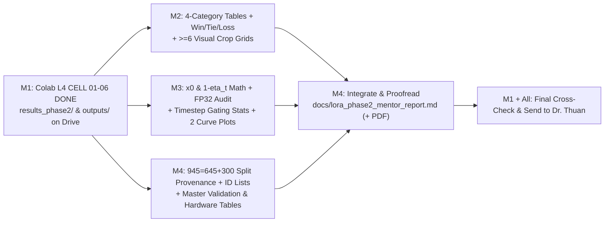

# Team Task Division, Dependencies & Post-GPU Handoff — Phase 2 LoRA Sweep & 2,000-Step Report

**Project:** SC203 Scientific Methods (Class 25A02) — Team 1 (`LEMMEPASS`)  
**Scope:** Mentor Dr. Thuận's Phase-2 Directives (Real-CE $\times 4$ $\lambda_{\text{cons}}$ Sweep, Timestep Gating $t \le 499$, Base DoSSR & Bicubic Validation Baselines, & 2,000-Step Checkpoint Curves)  
**Target Branch:** `feat/baseline-runner` (also synced to `main`)  
**Master Reference Notebook:** [`notebooks/04_lora_sweep_and_2000step_colab.ipynb`](../notebooks/04_lora_sweep_and_2000step_colab.ipynb)  
**Technical Architecture Plan:** [`docs/plans/08_mentor_next_lora_sweep_and_2000step_plan.md`](plans/08_mentor_next_lora_sweep_and_2000step_plan.md)  
**Current Status:** **M1 GPU Execution (`CELL 01–06`, `seed=231`) 100% COMPLETED & ARCHIVED ON GOOGLE DRIVE** (`MyDrive/lemmepass/results_phase2/` & `MyDrive/lemmepass/outputs/`). Now in **Analysis & Report Integration Phase (M2, M3, M4)**.

---

## 1. Design Principle: Balanced Workload & Strict Non-Overlap

Every member owns **exclusive deliverables**. All Colab L4 GPU runs, 10-seed evaluations, LPIPS/PSNR/SSIM metrics, RapidOCR CSVs, training manifests, and validation reference patches are **already generated and archived on Google Drive**:

* **Drive Summary Folder (for M2, M3, M4):** `MyDrive/lemmepass/results_phase2/`
  * `phase2_lambda_sweep_comparison.json`
  * `phase2_timestep_gating_comparison.json`
  * `phase2_2000step_curves_s231.json`
  * `metrics_bicubic_realce_val_summary.csv`, `metrics_base_dossr_val_summary.csv`, & all `metrics_*_val_summary.csv` / `ocr_*_reconly/`
  * `manifests/` (`lora_run_manifest.json` + `lora_train_log.csv` for all 5 Phase-2 training runs)
  * `val_patches/{HR,LR}/` (all `30` `512x512` HR & `128x128` LR validation patches)
  * `realce_splits_manifest_populated.json` (`248,778` bytes — complete Train/Val scene & pair ID lists)
* **Drive Output PNGs (for M2 visual crops):** `MyDrive/lemmepass/outputs/` (`base-dossr-realce-val-10seed`, `val-lora2_s231_st1600-10seed`, `val-lora3_s231_st1600-10seed`, `val-lora3_s231_st2000-10seed`, `pilot-lora3-realce-val-10seed`, etc.)

| Member | ID | Role in Phase 2 | Status | Exact Ownership & Deliverables |
| :--- | :---: | :--- | :---: | :--- |
| **M1 — Hoàng Nguyên Anh** | `25125002` | **Team Lead & Colab L4 GPU Runner** | **DONE** *(GPU & Drive Archive)* | Executed `CELL 01–06` (FP32 `ControlLDM` check, 945-pair split manifest, Bicubic & Base DoSSR, $\lambda \in \{0.1, 0.2\}$, $t \le 499$, 2,000-step LoRA 2 & LoRA 3) and archived `results_phase2/`. **Does NOT write narrative sections** (does final team review before sending to mentor). |
| **M2 — Huỳnh Trần Gia Hân** | `25125042` | **Qualitative, Category Breakdown & Win/Tie/Loss Lead** | **READY NOW** | Owns 4 diagnostic categories (`numeric_or_date`, `latin_only`, `border_touching <= 16px`, `cjk_signage`), Solv-63 Win/Tie/Loss counts, and **manual visual crop comparison grids ($\ge 6$ boxes)** showing improved vs. degraded cases across `HR`, `Bicubic`, `Base DoSSR`, `LoRA 2 st1600`, `LoRA 3 (0.5)`, and `LoRA 3 (0.2, t<=499)` `st1600`/`st2000`. |
| **M3 — Hồ Quang Minh** | `25125060` | **Math Audit, FP32 Gradient Check, Timestep Gating & Curve Lead** | **READY NOW** | Owns Section 1 math derivation (`predict_x0_out_mix`, no $1-\eta_t$ div, `trunc_12`, `SpacedSampler`), CPU + live `ControlLDM` FP32 gradient check tables, sampled-$t$ & `cons_active_ratio` explanation (`manifests/`), root-cause analysis of `Base DoSSR` vs. fine-tuned LoRA, and **2 PNG curve plots (`0, 400..2000`)**. **Does NOT take over M2's category/crop writeup.** |
| **M4 — Nguyễn Phan Minh Nhật** | `25125033` | **Split Provenance, Master Tables & Mentor Report Lead** | **READY NOW** | Owns Dataset & Split Provenance (**945 = 645 `RealCE/train` + 300 untouched `RealCE/val`** + `realce_splits_manifest_populated.json` scene ID appendix), minibatch math (`1,600` vs `8,000`), Master Validation & Hardware/VRAM Tables (including `seed=777` budget note), and final integration + PDF export of `docs/lora_phase2_mentor_report.md`. |

---

## 2. Parallel Handoff Workflow & Dependencies

---

## 3. Completed Experimental Summary (Verified Reference Numbers)

> **Rule for M2, M3, and M4:** Use **only** these exact verified numbers (cross-checked against Colab stdout and `results_phase2/*.json` / `*.csv`) across all tables, plots, and prose.

### 3.1. Live `ControlLDM` & CPU FP32 Gradient Checks (2-Pass vs. Simultaneous Joint Graph)

| Check Scope (`FP32`, `alpha_text=5.0`) | Trainable LoRA Params | Joint Loss | Two-Pass Loss | Loss Abs Diff | Max Abs Grad Diff | Mean Abs Grad Diff | Relative $L_2$ Grad Diff |
| :--- | :---: | :---: | :---: | :---: | :---: | :---: | :---: |
| **Synthetic CPU (`grad_accum = 1`)** | 1-block toy | `2.50256610` | `2.50256628` | `1.79e-07` | **`0.0`** | **`0.0`** | **`0.0`** |
| **Synthetic CPU (`grad_accum = 4`)** | 1-block toy | `2.54860532` | `2.54860538` | `5.66e-08` | **`1.49e-08`** | **`1.70e-09`** | **`4.11e-08`** |
| **Live `ControlLDM` (`--verify-fp32-grad`)** | **`1,659,904`** (`256` tensors, all non-zero) | `2.17437720` | `2.17437711` | `9.54e-08` | **`1.93e-07`** | **`9.60e-10`** | **`2.08e-05`** |

### 3.2. Locked Phase-2 Config & Master Validation Table (`Real-CE Val`: 30 Patches, 154 All / 63 HR-Solvable, Fixed Seeds `42..51`)

* **Locked Config from Gates 1 & 2:** **`lambda_cons = 0.2`**, **`cons_t_max = 499` ($t \le 499$)** (matching DoSSR `trunc_12` $t_1 = 500$ and `SpacedSampler` `[499, 399, 299, 200, 100]`).
* **Peak Validation Checkpoint:** **`lora3_s231_st1600`** (`6,400` minibatches), winning `LoRA 2` at **every** step (`400..2000`) and eliminating Pilot $\lambda=0.5$'s digit/LPIPS over-smoothing before mild overfitting begins at `step 2000`.

| Method / Checkpoint | Opt Steps / Minibatches | All-154 BoxErr | All-154 CER | All-154 Disag | Solv-63 BoxErr | Solv-63 CER | Solv-63 Disag | Solv CER W/T/L *(vs. L2 st400)* | Solv BoxErr W/T/L *(vs. L2 st400)* | `PSNR_Y` (dB) | `SSIM_Y` | Patch LPIPS | `pair_px` | `pair_lpips` |
| :--- | :---: | :---: | :---: | :---: | :---: | :---: | :---: | :---: | :---: | :---: | :---: | :---: | :---: | :---: |
| **HR Ceiling** | --- | 59.09% | 0.2908 | --- | 0.00% | 0.0000 | --- | --- | --- | --- | --- | 0.0000 | --- | --- |
| **Bicubic $\times 4$** | --- | 80.52% | 0.5770 | --- | 55.56% | 0.4184 | --- | --- | --- | 18.4606 | 0.6381 | 0.5888 | 0.000 | 0.0000 |
| **Base DoSSR (unmodified)** | 0 / 0 | **86.36%** | **0.6263** | **34.85%** | **69.21%** | **0.4887** | **36.90%** | 38 / 21 / 4 | 21 / 41 / 1 | 17.6307 | 0.6345 | **0.3928** | 7.486 | 0.1267 |
| **LoRA 2 ($\lambda=0.0$, 400st)** | 400 / 1,600 | 91.82% | 0.7241 | 47.69% | 82.22% | 0.6144 | 51.71% | 0 / 63 / 0 | 0 / 63 / 0 | 17.6980 | 0.6442 | 0.4231 | 9.272 | 0.2020 |
| **LoRA 3 ($\lambda=0.1$, `full_t`)** | 400 / 1,600 | 91.43% | 0.7222 | 46.08% | 81.27% | 0.6126 | 49.66% | 17 / 32 / 14 | 6 / 56 / 1 | 17.8640 | 0.6572 | 0.4301 | 7.506 | 0.1551 |
| **LoRA 3 ($\lambda=0.2$, `full_t`)** | 400 / 1,600 | 90.52% | 0.7098 | 45.04% | 79.37% | 0.5918 | 48.29% | 26 / 29 / 8 | 13 / 48 / 2 | 17.9798 | 0.6647 | 0.4411 | 6.192 | 0.1191 |
| **LoRA 3 ($\lambda=0.5$, pilot)** | 400 / 1,600 | 89.42% | 0.6942 | 41.21% | 76.03% | 0.5803 | 41.73% | 31 / 22 / 10 | 17 / 46 / 0 | 18.2828 | 0.6742 | 0.4711 | 3.941 | 0.0726 |
| **LoRA 3 ($\lambda=0.2$, $t\le 499$)** | 400 / 1,600 | 90.65% | 0.7113 | 45.04% | 79.68% | 0.5962 | 48.32% | 24 / 31 / 8 | 14 / 47 / 2 | 17.9891 | 0.6645 | 0.4411 | 6.226 | 0.1228 |
| `lora2_s231_st0800` | 800 / 3,200 | 91.36% | 0.7297 | 46.91% | 81.75% | 0.6206 | 51.11% | 15 / 30 / 18 | 7 / 51 / 5 | 17.7600 | --- | 0.4298 | 8.973 | --- |
| `lora2_s231_st1200` | 1,200 / 4,800 | 90.91% | 0.7129 | 45.34% | 79.37% | 0.5952 | 50.93% | 29 / 22 / 12 | 16 / 44 / 3 | 17.5777 | --- | 0.4107 | 9.164 | --- |
| `lora2_s231_st1600` | 1,600 / 6,400 | 90.06% | 0.6995 | 44.75% | 77.46% | 0.5759 | 50.26% | 35 / 19 / 9 | 16 / 46 / 1 | 17.5143 | --- | 0.4091 | 9.790 | --- |
| `lora2_s231_st2000` | 2,000 / 8,000 | 90.13% | 0.7101 | 43.32% | 78.25% | 0.5944 | 46.67% | 26 / 23 / 14 | 12 / 48 / 3 | 17.8984 | --- | 0.4167 | 8.951 | --- |
| `lora3_s231_st0800` | 800 / 3,200 | 90.58% | 0.7167 | 44.20% | 79.68% | 0.6078 | 47.55% | 19 / 27 / 17 | 13 / 46 / 4 | 18.0584 | --- | 0.4551 | 5.786 | --- |
| `lora3_s231_st1200` | 1,200 / 4,800 | 90.19% | 0.7019 | 43.95% | 77.46% | 0.5817 | 48.36% | 26 / 26 / 11 | 14 / 48 / 1 | 17.8718 | --- | 0.4401 | 6.267 | --- |
| **`lora3_s231_st1600` (BEST LORA)** | **1,600 / 6,400** | **88.64%** | **0.6809** | **42.38%** | **74.13%** | **0.5488** | **46.98%** | **36 / 22 / 5** | **20 / 43 / 0** | **17.7842** | **0.6652** | **0.4252** | **6.816** | **0.1183** |
| `lora3_s231_st2000` | 2,000 / 8,000 | 89.29% | 0.6889 | 42.05% | 76.03% | 0.5680 | 46.10% | 29 / 23 / 11 | 18 / 43 / 2 | 18.1403 | --- | 0.4422 | 5.888 | --- |

* **Solvable-63 Diagnostic Category CER Highlights at Peak (`lora3_s231_st1600`):**
  * `numeric_or_date` (24 solv / 50 all): **`0.5440`** CER (`75.4%` BoxErr) vs. Pilot $\lambda=0.5$ `0.5865` & LoRA 2 `st1600` `0.5581` (almost tied with Base DoSSR `0.5347`).
  * `latin_only` (16 solv / 67 all): **`0.3899`** CER (`66.2%` BoxErr) vs. LoRA 2 `st1600` `0.3991`.
  * `border_touching` (27 solv / 73 all): **`0.6405`** CER (`82.2%` BoxErr) vs. LoRA 2 `st1600` `0.6701`.
  * `cjk_signage` (35 solv / 68 all): **`0.6387`** CER (`80.6%` BoxErr, `38.41%` Disag) vs. LoRA 2 `st1600` `0.6834`.
* **Honest Scientific Takeaway (`Base DoSSR` vs. Fine-Tuned LoRA):** `lora3_s231_st1600` beats Base DoSSR on whole-patch `PSNR_Y` (`17.7842` vs `17.6307`), `SSIM_Y` (`0.6652` vs `0.6345`), and cross-seed visual spread (`pair_px: 6.816` vs `7.486`; `pair_lpips: 0.1183` vs `0.1267`), **while Base DoSSR still leads on aggregate OCR (`69.21%` vs `74.13%` Solv-63 BoxErr)**. Why: reconstruction loss $\mathcal{L}_{\text{rec}}$ stayed active across all $t \in [0, 999]$ (`50.65%` of `8,000` minibatches fell in $t \ge 500$ where $1 - \eta_t \equiv 0$, i.e., zero HR signal and unused by 5-step inference), so LoRA 2 started with a `-13.01` pp handicap vs Base DoSSR (`82.22%` vs `69.21%`) that $\mathcal{L}_{\text{cons}}$ partially repaired (`82.22% -> 74.13%`).

### 3.3. Hardware, VRAM, Timing & Timestep Accounting (`seed=231`, `grad_accum=4`)

| Run | Steps / Minibatches | Sampled $t$ (`mean`, `t<500`) | Active $\mathcal{L}_{\text{cons}}$ | Peak VRAM (Alloc / Res) | `mean` / `p95` `s/step` | Est. Wall Time |
| :--- | :---: | :---: | :---: | :---: | :---: | :---: |
| `lora3-lambda01-pilot` | `400` / `1,600` | `488.89` (`814/1600 = 50.88%`) | `100.00%` | `8.04 / 8.54 GiB` | `5.4411 / 5.4775 s` | `36.3 min` |
| `lora3-lambda02-pilot` | `400` / `1,600` | `488.89` (`814/1600 = 50.88%`) | `100.00%` | `8.04 / 8.52 GiB` | `5.4357 / 5.4833 s` | `36.2 min` |
| `lora3-t499-pilot` | `400` / `1,600` | `488.89` (`814/1600 = 50.88%`) | **`50.88%`** | `8.04 / 8.52 GiB` | **`5.1045 / 5.4376 s`** | `34.0 min` |
| `lora2-full2000-s231` | `2,000` / `8,000` | `502.16` (`3948/8000 = 49.35%`) | `0.00%` | `8.04 / 8.52 GiB` | `4.7407 / 4.7931 s` | `2.63 hr` |
| `lora3-full2000-s231` | `2,000` / `8,000` | `502.16` (`3948/8000 = 49.35%`) | **`49.35%`** | `8.04 / 8.52 GiB` (`+0.00`) | **`5.1035 / 5.4305 s`** | `2.84 hr` |

*(Note on 2nd training seed `seed=777`: skipped due to Colab L4 quota constraints — running 1 full 2,000-step paired study + 10 intermediate checkpoint 10-seed evaluations already consumed ~7 hours of L4 GPU time.)*

---

## 4. Detailed Tasks, Inputs, & Acceptance Criteria by Member

### M1 — Hoàng Nguyên Anh (`25125002`) — Colab L4 GPU Execution & Artifact Sync (**GPU WORK DONE**)
* [x] **`M1-1` (`CELL 01–02`):** Verified repo sync, CPU/FP32/$\eta_t$ checks, **645 `train` + 300 `val` = 945 total pairs**, generated `realce_splits_manifest_populated.json` (`248,778` bytes), and backed up to `results_phase2/`.
* [x] **`M1-2` (`CELL 03`):** Executed Bicubic $\times 4$ & unmodified **Base DoSSR** (`10` seeds `42..51`, `per_image_seed: true`, `disable_sdpa: true`) + RapidOCR `--rec-only --rotate-vertical --upscale 2`.
* [x] **`M1-3` (`CELL 04`):** Completed 400-step sweep for **`lambda_cons = 0.1`** (with live `ControlLDM` `--verify-fp32-grad`) and **`lambda_cons = 0.2`**, locked `SELECTED_LAMBDA = 0.2`.
* [x] **`M1-4` (`CELL 05`):** Completed 400-step timestep-restricted training (`cons_t_max=499`, `814/1600 = 50.88%` active), locked `FINAL_CONS_T_MAX = 499`.
* [x] **`M1-5` (`CELL 06` & Backup):** Completed **2,000-step** LoRA 2 & LoRA 3 (`8,000` minibatches, `save_every=400`), evaluated all checkpoints `400..2000`, and backed up `manifests/`, `val_patches/{HR,LR}/`, and `realce_splits_manifest_populated.json` inside `MyDrive/lemmepass/results_phase2/`.
* [ ] **`M1-6` (Final Review):** Spend ~5 minutes sanity-checking M4's integrated report before sending to Dr. Thuận.

---

### M2 — Huỳnh Trần Gia Hân (`25125042`) — Category Breakdown, Win/Tie/Loss & Visual Crop Audit (**DO NOW**)
* **Drive Inputs:** `results_phase2/phase2_*.json`, `results_phase2/val_patches/{HR,LR}/`, and `outputs/{base-dossr-realce-val-10seed, val-lora2_s231_st1600-10seed, val-lora3_s231_st1600-10seed, val-lora3_s231_st2000-10seed, pilot-lora3-realce-val-10seed}/`.
* **Checklist:**
  1. **`M2-1` (4-Category & Win/Tie/Loss Tables):** Extract full `All-154` and `Solvable-63` tables across all 4 diagnostic categories (`numeric_or_date` 24/50, `latin_only` 16/67, `border_touching <= 16px` 27/73, `cjk_signage` 35/68) and Win/Tie/Loss transitions comparing `Base DoSSR`, `LoRA 2` (`st0400`, `st1600`), `LoRA 3` ($\lambda \in \{0.1, 0.2, 0.5\}$), and `LoRA 3 (0.2, t<=499)` (`st0400`, `st1600`, `st2000`). Highlight how `st1600` pulls `numeric_or_date` Solv CER down from `0.5865` (`\lambda=0.5`) to **`0.5440`** (near `Base DoSSR` `0.5347`).
  2. **`M2-2` (Side-by-Side Visual Crop Grids — Minimum 6 Boxes):** Crop and arrange side-by-side panels (`HR | Bicubic | Base DoSSR | LoRA 2 st1600 | LoRA 3 (lam=0.5) | LoRA 3 st1600 | LoRA 3 st2000`) covering both **improved and degraded cases**:
     * **2 Numeric / Date boxes:** `ip12pro_output_100APPLE_renew_29_patch000.png` box 1 (`"2024/06/17"`) + 1 numeric box that clearly improved at `st1600`.
     * **2 Latin boxes:** `ip11pro_output_TextSR_renew_114_patch000.png` box 1 (`"paas"`, where `st1200/st2000` reached `50.0%` BoxErr vs `Base DoSSR` `60.0%`) + 1 additional Latin box.
     * **2 Border-Touching / CJK boxes:** `ip11pro_output_TextSR_renew_114_patch000.png` box 5 (`"本书都很有帮助。"`, where `LoRA 3 st1600` CER `0.7500` beat `Base DoSSR` `0.7750`) + `ip11pro_output_TextSR_renew_101_patch000.png` box 3 (`"集成方法、"`) or box 5 (`"的监督学习算法"`).
  3. **`M2-3` (Qualitative Note & Handoff):** Write concise analytical notes listing exact `(image, box_id, seed)` and OCR transcripts explaining why thin slashes (`2024/06/17`) degrade while thicker Latin/CJK strokes stabilize, then pass tables + crop grid PNGs to **M4**.
* **Acceptance:** Completed category + Win/Tie/Loss markdown tables and $\ge 6$ clean side-by-side crop PNGs delivered to M4.

---

### M3 — Hồ Quang Minh (`25125060`) — Math Derivation, FP32 Audit, Timestep Gating & 2,000-Step Curves (**DO NOW**)
* **Inputs:** [`docs/plans/08_mentor_next_lora_sweep_and_2000step_plan.md`](plans/08_mentor_next_lora_sweep_and_2000step_plan.md), `results_phase2/manifests/*`, `results_phase2/phase2_timestep_gating_comparison.json`, and `results_phase2/phase2_2000step_curves_s231.json`.
* **Checklist:**
  1. **`M3-1` (Math & Backward Audit Section):** Write the rigorous Section 1 & 2 narrative explaining:
     * Exact UNet $\hat{\epsilon}_\theta \to \hat{x}_0$ conversion in [`ddpm.py:909-917`](../external/DOSSR/ldm/models/diffusion/ddpm.py#L909-L917) & `ddpm.py:293-297`.
     * Explicit proof that **training divides by $\sqrt{\bar{\alpha}_t}$**, not $1 - \eta_t$; exact behavior of $1 - \eta_t$ at $t=499$ ($2.4674 \times 10^{-6}$) vs. $t \in [500, 999]$ ($0.0$, meaning $x_{\text{rect}}(t) = \hat{x}_{\text{LR}}$ contains 0% HR signal).
     * Proof that [`SpacedSampler`](../external/DOSSR/model/shift_sampler.py#L48-L61) queries UNet strictly at `[499, 399, 299, 200, 100]` $\implies$ justifies `cons_t_max = 499`.
     * Complete FP32 two-pass vs. simultaneous joint gradient table covering both CPU tests and the **live `ControlLDM` test (`1,659,904` params, `rel_l2 = 2.08e-05`)**.
  2. **`M3-2` (Timestep Gating & `Base DoSSR` Root-Cause Section):** Summarize `t_sampled` and `cons_active_ratio` from `manifests/` (`400` steps: `t_mean=488.89`, `814/1600 = 50.88%` active; `2,000` steps: `t_mean=502.16`, `3,948/8,000 = 49.35%` active). Compare `full_t` vs. `t<=499` (`numeric_or_date` CER improves `0.5754 -> 0.5732`, `~6%` faster) and diagnose why `Base DoSSR` still leads on OCR (because $\mathcal{L}_{\text{rec}}$ stayed active on $t \ge 500$, warping LoRA 2 before $\mathcal{L}_{\text{cons}}$ could recover it).
  3. **`M3-3` (2,000-Step Validation Curves):** Plot 2 publication-clean PNG charts across steps `0 (Base DoSSR dashed reference), 400, 800, 1200, 1600, 2000` for `LoRA 2` vs. `LoRA 3`:
     * **Plot 1:** `Solv-63 Box Error Rate (%)` & `Solv-63 Mean CER` vs. Step (annotating `step 1600` peak `74.13%` / `0.5488` and `step 2000` mild overfitting `76.03%`).
     * **Plot 2:** `Solv-63 Seed OCR Disagreement (%)`, `Whole-Patch LPIPS`, and `pair_px` vs. Step (highlighting `pair_px = 6.816` at `st1600` beating `Base DoSSR` `7.486`).
  4. **`M3-4` (Handoff):** Send finished Section 1–2 text, timestep-gating narrative, and 2 PNG plots to **M4**.
* **Acceptance:** Zero formula errors, exact match with `manifests/` & JSON numbers, and 2 high-DPI readable PNG plots delivered to M4.

---

### M4 — Nguyễn Phan Minh Nhật (`25125033`) — Split Provenance, Master Tables & Report Assembly (**DO NOW**)
* **Inputs:** `results_phase2/realce_splits_manifest_populated.json`, `results_phase2/metrics_bicubic_realce_val_summary.csv`, `results_phase2/manifests/*`, `results_phase2/phase2_*.json`, plus deliverables from M2 & M3.
* **Checklist:**
  1. **`M4-1` (Dataset & Split Provenance Section):** Write the provenance section reconciling **`945` total $4\times$ pairs = `645` official `RealCE/train` + `300` official `RealCE/val`** (left 100% untouched for final test benchmark), explaining how `scripts/split_realce_by_scene.py --split train --val-ratio 0.20 --seed 42` partitioned only the `645` pairs with `Train scenes ∩ Val scenes = ∅`. Export/attach the complete Train/Val scene & patch ID list appendix from `realce_splits_manifest_populated.json`.
  2. **`M4-2` (Master Validation & Hardware Tables):** Build the two master tables using Section 3 numbers above:
     * **Master Validation Table:** `HR Ceiling`, `Bicubic x4` (`PSNR_Y=18.4606`, `LPIPS=0.5888`), `Base DoSSR` (`LPIPS=0.3928`, `Solv BoxErr=69.21%`), `LoRA 2 (0.0)`, `LoRA 3 (0.1, 0.2, 0.5, t<=499)`, and `2,000`-step `st1600`/`st2000`.
     * **Compute & Minibatch Table:** Trainable params (`1,659,904`), minibatch equivalence (`400 x 4 = 1,600`; `2,000 x 4 = 8,000`), VRAM (`8.04 GiB alloc / 8.52 GiB res`, `+0.00 GiB`), mean/p95 `s/step`, estimated wall hours (`~2.84h`), plus a transparent note on why the optional 2nd seed (`777`) was deferred after consuming ~7h L4 budget on `seed=231`.
  3. **`M4-3` (Final Report Assembly & Number Audit):** Integrate M2's category tables & visual crops + M3's math proofs, timestep diagnosis, & curve PNGs into **`docs/lora_phase2_mentor_report.md`** (and compile a clean PDF). Verify 100% numeric consistency across prose, tables, and figures before handing to M1 for final sign-off.
* **Acceptance:** Cohesive, publication-clean Mentor Update Report directly answering every bullet of Dr. Thuận's message.

---

## 5. Verification Before Sending Phase-2 Report to Mentor
- [x] Math audit confirms no $1-\eta_t$ division in training and proves why `cons_t_max = 499` matches `trunc_12` ($t_1 = 500$) and `SpacedSampler` `[499, 399, 299, 200, 100]`.
- [x] FP32 gradient check verified on both CPU (`rel_l2 = 4.11e-08`) and live `ControlLDM` (`1,659,904` params, `rel_l2 = 2.08e-05`).
- [x] Sweep, timestep gating, `Base DoSSR`, `Bicubic x4`, and `2,000`-step checkpoint (`400..2000`) runs executed on identical `seed 42..51` noises (`per_image_seed: true`) and archived in `MyDrive/lemmepass/results_phase2/`.
- [ ] **M2:** Category breakdown + Win/Tie/Loss tables + $\ge 6$ side-by-side crop comparison grids (numeric/date `2024/06/17`, Latin `paas`, border/CJK boxes).
- [ ] **M3:** Integrated Math/FP32 + Timestep Gating writeup + 2 validation curve PNG plots (`0, 400..2000`).
- [ ] **M4 (+ M1 Review):** `645/300 -> 945` split ID appendix, Master Validation & Hardware Tables, and final proofread `docs/lora_phase2_mentor_report.md` / PDF ready to send to Dr. Thuận.
